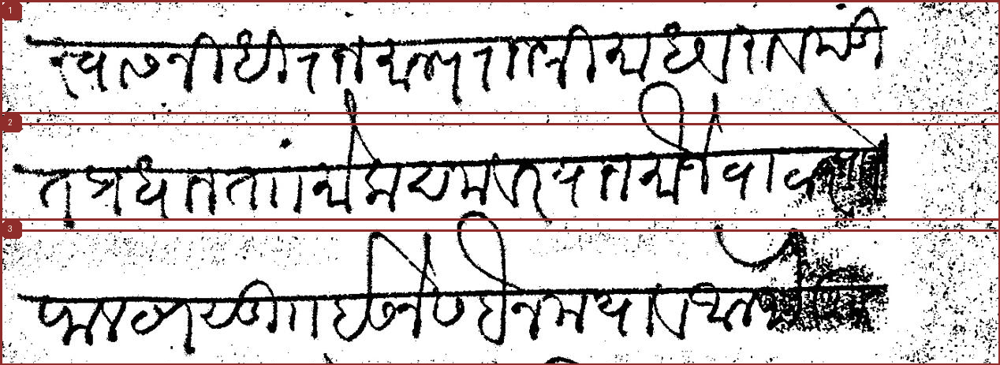
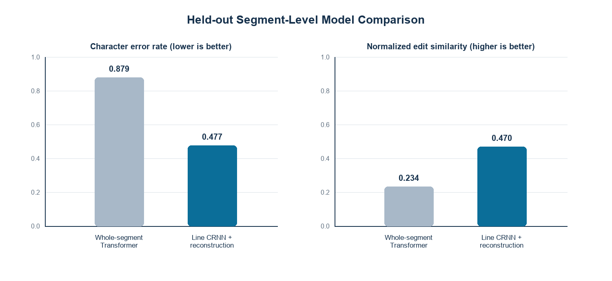
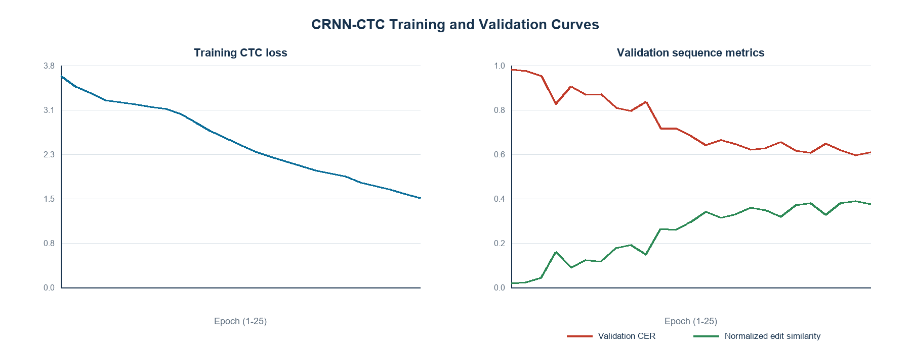

## 7. Implementation and Integration Details

The implemented system converts scanned Modi manuscript segments into draft Devanagari text. This CIE update records the packaged implementation and checks executed on 16 November 2026. It updates the October implementation and validation status in the earlier sections; the frozen seed-2026 model results remain unchanged.

### 7.1 Module-wise Implementation of Functional Requirements

The Transformer baseline (M3, FR05) and shared metrics (M6, FR08) form the evaluation branch. Training uses manifests and pseudo-line targets; interactive inference requires only the CRNN checkpoint and an input image.

| FR | Implemented module and algorithm | Status and evidence |
| --- | --- | --- |
| FR01 | prepare_dataset.py and text.py: whitespace normalisation, paired manifests and Unicode vocabulary. | Implemented; text encode/decode core test passes. |
| FR02 | Filename-block split with seed 2026; parent/crop provenance retained. | 1,680 / 123 / 240 parents; 6,019 inherited crop splits; zero crossings. |
| FR03 | line_segmentation.py: Otsu-based ink mask, smoothed horizontal projection, gap selection and padded boxes. | Implemented; ordered three-line synthetic case and real sample pass. |
| FR04 | Width-proportional dynamic programming partitions transcript words across detected lines. | Implemented; joined pseudo-labels preserve target text. Expert label accuracy unmeasured. |
| FR05 | model.py and train.py: random-initialised CNN-Transformer with bounded generation. | Implemented; five-epoch checkpoint and 240-segment saved evaluation included. |
| FR06 | crnn.py: four-stage CNN, two-layer bidirectional GRU and CTC; 64-pixel height, width capped at 1,024. | Implemented; 2,180,828 parameters; strict checkpoint loading and 787-line evaluation pass. |
| FR07 | Reading-order reconstruction; UTF-8 TXT, structured JSON and marked PNG. | Implemented; actual download content and line ordering validated. |
| FR08 | metrics.py: Levenshtein CER, normalised edit similarity and exact match. | Implemented; arithmetic unit test and complete CRNN metric reproduction pass. |
| FR09 | streamlit_app.py: upload, cached engine, example image, recognition and download controls. | Implemented locally; AppTest workflow and HTTP 200 checks pass. |

---

### 7.2 Non-Functional Requirement Implementation

| NFR | Mechanism and measurable evidence | Status |
| --- | --- | --- |
| NFR01 | Reconstructed parent CER 0.4772 versus baseline 0.8794; similarity 0.4704; exact match 0.0000. | Stated criterion met; expert review required. |
| NFR02 | Seed 2026, saved configuration, history, predictions and model hashes; full CRNN evaluation reproduces saved metrics. | Verified for packaged checkpoints and local source data. |
| NFR03 | Unique parents; all 6,019 crops inherit splits; zero crossing source groups and zero cross-split exact-image SHA-256 hashes. | Verified; document/writer independence remains unproven. |
| NFR04 | Five core tests; invalid, constant blank and oversized uploads rejected; new image invalidates old result. | Verified locally with automated application tests. |
| NFR05 | Local server and health endpoint both return HTTP 200; example recognition and three export types validated. | Local criterion met; separate-host deployment pending. |

Resource use. st.cache_resource reuses the model. Detected lines are padded to the current batch width and inferred in one batch under torch.inference_mode. The engine uses CUDA when available and otherwise CPU. The reported UI timer measures the model call, excluding upload decoding, initial model load and display overhead; it is not an end-to-end latency benchmark.

Input handling. EXIF orientation is applied, inputs are converted to grayscale and file size is limited to 25 MiB. The review package adds a pre-inference rejection for constant images and confines checkpoint auditing to outputs/, avoiding Python environment .pth files. Authentication, encryption and sustained-load capacity are not certified.

### 7.3 Integration Details

Integration proceeds from text and metrics tests to model tensor tests, line preparation, split auditing, checkpoint loading, held-out evaluation and the interactive workflow. File paths are resolved from the project directory rather than the working directory, allowing a clean repository checkout to locate the bundled model and examples.

open_image(bytes) returns a validated PIL image. detect_line_regions(image) returns ordered LineRegion boxes. prepare_line_image produces normalised tensors and valid widths. load_model restores the vocabulary and strict model state; greedy CTC decoding removes blanks and repeated adjacent IDs. recognize(image) returns lines, combined_text, line_count, confidences, overlay, device and model-call time.

Downloads are generated from the recognition result as UTF-8 text, JSON with source and ordered line records, and a PNG overlay. A SHA-256 digest of source bytes invalidates stale results. ValueError, RuntimeError and OSError are surfaced as user-readable errors. No database or external recognition API is required.

---

### 7.4 Source Code and Git Repository Organization

Repository: https://github.com/nmit-1NT23CS150/ Epigraphy-sculpture-recognition-and-conversion

| Item | Actual repository information |
| --- | --- |
| Owner | GitHub account nmit-1NT23CS150; Group 20 project submission. |
| Primary branch | main; the CIE package is the initial import into the previously empty target repository. |
| Development history | Existing local Modi implementation is the source. The initial import does not establish incremental semester-long development in this target repository. |
| Naming conventions | Lower-case Python module names; snake_case functions; separate package, scripts, tests, docs and evidence directories. |
| README | Setup, example recognition, validation, reproduction, results, attribution and deployment instructions. |
| Release and tags | No previous release or tag is asserted. Recorded checkpoint hashes identify the demonstrated models. |
| Included runtime assets | Seed-2026 CRNN and Transformer checkpoints, two demo images, configs, histories and saved evaluation outputs. |
| Excluded local assets | Virtual environments, raw dataset download, full image/crop collection, local manifests, caches and secrets. |

The following is the actual package layout. Full dataset manifests are recreated with prepare_dataset.py and prepare_lines.py; the demonstration works immediately from the included assets.

Checkpoint identity. CRNN SHA-256: 48f77f1e5d2db95942f82dcbf7caae4bc2f60471494e3bdd48c564e2bc0672b7 Transformer SHA-256: 1ae8460810816e0b555783aab1eb4dd32b2cdd94b3828fc9b041b5798256c91e

---

### 7.5 Implementation Artifacts

The repository includes executable source modules, trained checkpoint files, run configurations, histories, saved predictions, comparison and training plots, core tests and dated validation evidence. The bundled examples come from MoDeTrans; dataset attribution accompanies the source. No Brahmi or Egyptian-script weights are used.

| Artifact | Purpose and location |
| --- | --- |
| Trained models | outputs/crnn_main_seed_2026/best.pt and outputs/baseline_seed_2026/best.pt. |
| Recorded results | Each run retains history.json, run_config.json and evaluation_test/ metrics and predictions. |
| Review evidence | evidence/review_validation.json, core_tests.log, isolation_audit.json, heldout_evaluation.log and http_smoke.json. |
| Actual inference exports | evidence/modi_transliteration.txt, modi_transliteration.json and modi_detected_lines.png. |
| Presentation support | docs/DEMO_GUIDE.md; Dockerfile and Run_Demo.bat for launch and deployment preparation. |

The example request produced three Devanagari line strings and a combined draft. Automated checks verified that TXT and JSON contain the same text, JSON preserves line order and the PNG is a valid image. The actual Unicode output is retained in the downloadable evidence files so that it can be compared with the source image during the presentation.

The confidence display is calculated from emitted CTC character probabilities and is not calibrated against human correctness. It must not be interpreted as the accuracy of a manuscript transcription.

---

## 8. Deployability and Validation

Local execution and application validation were completed for the CIE package on 16 November 2026. The repository also contains a deployment recipe. A separate-host deployment has not been executed; the local results below do not certify that review requirement.

### 8.1 Deployment Environment

| Property | Verified environment or deployment status |
| --- | --- |
| Target tested | Windows authoring laptop; separately packaged GitHub project directory using the existing Python environment. |
| Runtime | Python 3.12.10; PyTorch 2.5.1+cu121; Streamlit 1.59.2. |
| Model resources | CRNN checkpoint and vocabulary embedded in the saved model; model chooses CUDA if available and CPU otherwise. |
| Local network | 127.0.0.1:8502; homepage HTTP 200 and /_stcore/health HTTP 200 with response ok. |
| Container recipe | python:3.12-slim with CPU PyTorch 2.5.1, non-root reviewer user, port 8502 and HTTP health check. |
| External deployment | Not executed. Docker is unavailable here and no separate presentation host has been configured. |
| Evidence boundary | A clean package directory is not a separate machine or an independent installed environment; GitHub source hosting is not live application hosting. |

To deploy on the presentation machine, install Python 3.12 and the requirements, then launch Streamlit using the README commands. Alternatively, build epigraphy-modi:phase2 from Dockerfile and run it with port 8502 published. Record the target OS/hardware, dependency installation or image-build log, model hash and URL before running the deployed acceptance tests.

### 8.2 Deployment Architecture

The browser uploads one image to Streamlit. The same service performs validation, segmentation, inference and export generation. There is no separate inference API, database or cloud dependency. Local mode binds only to loopback. Container mode binds inside the container to 0.0.0.0 and publishes the configured port on its host.

For a public service, access control, transport protection, pixel/decompression limits, resource controls and an operational retention policy require additional implementation and validation. The current package is intended for a controlled academic demonstration.

---

### 8.3 Validation of Test Scenarios in Deployed Conditions

Tests below ran on the packaged local application, not on a separate target host. The core suite has five pytest tests. Additional application, integrity, evaluation and boundary checks are recorded in evidence/review_validation.json; HTTP startup evidence is stored separately.

| TC / requirement | Scenario and acceptance criterion | Observed result / status |
| --- | --- | --- |
| TC01 / FR01 NFR04 | Normalise whitespace; vocabulary encode/decode round trip. | Pass; expected Devanagari text preserved. |
| TC02 / FR08 NFR04 | Edit distance 1 on the controlled example; exact-match fraction 0.5 over two examples. | Pass; metric arithmetic correct. |
| TC03 / FR05 NFR04 | Transformer forward dimensions and generated length capped at four. | Pass; tensor and length assertions met. |
| TC04 / FR03 FR04 | Detect three synthetic lines; allocate three labels preserving the joined target. | Pass; three boxes and text preservation. |
| TC05 / FR06 NFR04 | CRNN batch dimension, vocabulary including CTC blank and non-empty target encoding. | Pass; forward and vocabulary assertions met. |
| TC06 / FR02 NFR02 NFR03 | Check parent uniqueness, split counts, crop inheritance, crossing groups, hashes and checkpoint provenance. | Pass; 2,043 parents, 6,019 crops, zero split violations and exact cross-split duplicates. |
| TC07 / FR05 FR08 NFR02 | Inspect saved Transformer test metrics on 240 segments and checkpoint identity. | Saved evaluation verified; CER 0.8794. Baseline inference was not rerun for this update. |
| TC08 / FR06 FR07 FR08 NFR01 | Rerun all 787 held-out CRNN lines and reconstruct 240 parents. | Pass; full metric JSON exactly reproduces recorded evaluation; parent CER 0.4772. |
| TC09 / FR03 FR06 FR07 | Run actual sample through packaged checkpoint and check reading order. | Pass; three lines; combined text follows line order. |
| TC10 / FR09 NFR05 | Start app, recognize example, validate TXT/JSON/PNG, replace source and check HTTP. | Pass locally; exports agree, stale output cleared; homepage and health HTTP 200. |

Requirement acceptance. TC07 verifies recorded reporting artifacts rather than a newly executed baseline benchmark. TC08 confirms that the CRNN meets NFR01 relative to that saved baseline. TC10 completes the earlier partial application check at the automated Streamlit level; cross-browser and separate-host certification remain pending.

---

### 8.3 Validation of Test Scenarios Continued

| TC / category | Acceptance criterion | Observed result |
| --- | --- | --- |
| TC11 / Negative reliability | Unreadable bytes and constant white input must produce a readable error without a transcription. | Pass; corrupt input rejected during decoding; blank input rejected before inference. |
| TC12 / Boundary | 25 MiB input accepted; one byte above this limit rejected. | Pass at 26,214,400 bytes; rejected at 26,214,401 bytes. |
| External deployment acceptance | On the separate host: health check, real upload, inference, exports, error cases and model identity. | Not executed; requires an actual deployment target. |

Summary. All 12 local test scenarios have supporting results: 11 were executed in the current checks, while TC07 was checked against its saved evaluation. The automated runner reports 15 passed assertions/check groups and zero failures; both separate HTTP checks passed. The 15 groups are not 15 independent model benchmarks. External deployment validation is pending.

Coverage and limits. Functional, boundary, negative, data integrity and application regression checks are covered. The checks do not establish public-service security, 24-hour reliability, concurrency capacity, memory limits or stable latency. No hardware validation, stress test or penetration test was performed. The Dockerfile is supplied but not build-tested.

### 8.4 AI Model Validation Result and Analysis

| Split | Parent segments | Line crops |
| --- | --- | --- |
| Training | 1,680 | 4,873 |
| Validation | 123 | 359 |
| Held-out test | 240 | 787 |
| Total | 2,043 | 6,019 |

Parent segments are grouped by consecutive filename blocks before deterministic splitting. Every crop inherits its parent split. No exact image hash crosses splits in the verified source collection. Reliable document and writer identifiers are absent, so the split is not proven document- or writer-disjoint. Cross-validation was not used.

| System and unit | CER | Similarity | Exact match |
| --- | --- | --- | --- |
| CNN-Transformer, 240 parents | 0.8794 | 0.2341 | 0.0000 |
| CRNN-CTC, 787 pseudo-labelled lines | 0.5593 | 0.4025 | 0.0000 |
| CRNN-CTC reconstructed, 240 parents | 0.4772 | 0.4704 | 0.0000 |

CER is total Levenshtein edits divided by reference characters. Similarity averages max(0, 1 - edit_distance / max(reference_length, prediction_length, 1)) across samples. Exact match is the proportion of fully matching normalised sequences. A classification confusion matrix is not the primary measure for this variable-length transcription task.

---

### 8.4 Model Comparison and Error Analysis

Reconstructed parent CER improves by 0.4022 absolute, approximately 45.7% relative to the baseline. Similarity rises by 0.2364. This is a complete-pipeline comparison: architecture, input granularity, batch size, learning rate, training duration and checkpoint selection differ. It does not identify the isolated causal contribution of line segmentation or establish superiority over published methods.

The CRNN used random initialisation, seed 2026, 25 epochs, batch size 24 and Adam learning rate 0.001. Epoch 24 was selected by lowest validation CER. Training took about 1,144.5 seconds in the recorded experiment; this is historical training time, not inference latency. The Transformer baseline ran for five epochs.

| Pipeline | Insertions | Deletions | Substitutions |
| --- | --- | --- | --- |
| Transformer | 6,845 | 8,736 | 16,549 |
| Reconstructed CRNN | 1,395 | 9,958 | 6,081 |

The earlier error analysis records fewer insertions and substitutions but more deletions for CRNN. Missing/collapsed characters are consistent with CTC decoding, pseudo-label noise or input truncation; these possible causes were not experimentally isolated. The current full CRNN evaluation reproduces its saved aggregate metrics.

---

### 8.4 Qualitative Validation and Limitations

The recorded qualitative examples select strong, median and challenging held-out cases near the 95th, 50th and 5th percentiles of similarity. They are illustrative selected cases and do not estimate the typical accuracy of future manuscripts.

| Case | Source segment | Similarity | Interpretation |
| --- | --- | --- | --- |
| Strong | mode_00099.png | 0.702 | Recognisable administrative fragments; substantial errors remain. |
| Median | mode_00402.png | 0.480 | Some phrase structure retained, with character omissions. |
| Challenging | mode_02007.png | 0.204 | Sparse/specialised text can collapse; review of the source is essential. |

Expected and actual Unicode sequences are retained in the evaluation prediction CSVs. During the demonstration, compare the marked source image with the exported draft; a plausible-looking word or high CTC score does not prove that a historical reading is correct.

### Limits of the Current Validation

Zero exact match. No entire held-out segment exactly matches its reference. The output is a transcription draft for a Modi-script expert, not an authoritative historical or legal reading.

Pseudo-line supervision. Targets are allocated from segment transcripts using widths and word boundaries. Expert line-boundary and line-transcript accuracy is unmeasured.

Evaluation scope. The reported comparison uses the seed-2026 runs and unequal budgets. No multi-seed claim, matched-budget conclusion or cross-archive generalisation is made here.

Robustness. Touching/skewed lines, decorative strokes, severe degradation and unusually long content can degrade detection and decoding. Input rejection tests are not an out-of-distribution recognition benchmark.

Runtime evidence. The UI and test-run timers are single-environment observations, not a controlled CPU/GPU latency or memory benchmark. Confidence estimates remain uncalibrated.

Deployment gap. Local application checks passed. The review requirement for deployment outside development remains open until the package is run and validated on a separate target.

### Demonstration and Technical Interview Readiness

Show example input, detected reading order, draft text, exported JSON/TXT/PNG and rejection of invalid input. Explain why CTC avoids character boxes, why pseudo-labels limit accuracy, how parent-split inheritance prevents crop leakage, and why 45.7% lower CER does not imply complete transcription accuracy. Use docs/DEMO_GUIDE.md for the review sequence and deployment evidence to capture.
